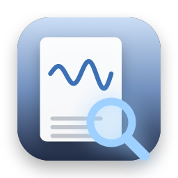
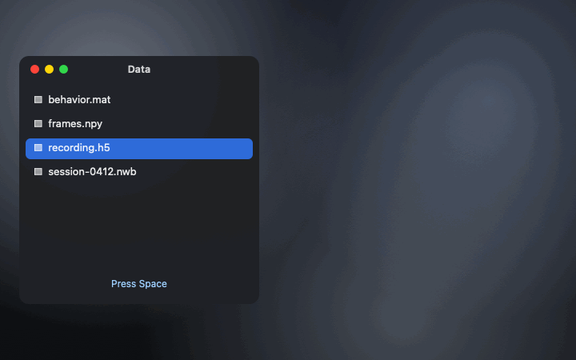

<p align="center">
  
</p>

<h1 align="center">SciLook</h1>

<p align="center">
  <b>Quick Look for scientific data on your Mac.</b><br>
  Select an NWB, HDF5, MATLAB or NumPy file in Finder, press Space, and see what's inside: its structure, its NWB session facts and a plot. Free, open source, sandboxed, no permissions.
</p>

<p align="center">
  <a href="https://github.com/stanczykwyatt/scilook/releases/latest/download/SciLook.zip"><b>Download for Mac</b></a>
  &nbsp;·&nbsp;
  <a href="https://stanczykwyatt.github.io/scilook/">Website</a>
  &nbsp;·&nbsp;
  <a href="https://github.com/users/stanczykwyatt/projects/1">Roadmap</a>
</p>

<p align="center">
  <a href="https://github.com/stanczykwyatt/scilook/actions/workflows/ci.yml"></a>
  
  
  
  <a href="LICENSE"></a>
</p>

<p align="center">
  
</p>

---

Finder can show you a PDF, a photo or a spreadsheet with one press of Space, but not the files science runs on. An `.h5`, `.nwb`, `.mat` or `.npy` file is a blank icon until you open Python or MATLAB. The old Quick Look plugins for HDF5 stopped working when macOS dropped that plugin type.

SciLook brings them back as a modern Quick Look extension. Press Space on a file and you see its groups and arrays with their shapes, types and units; for NWB files, the session and subject; and a plot of one array: the recorded signal, an image, or the largest thing in the file. Big HDF5 and NWB files are read a little at a time, so a 10 GB recording previews in a moment.

If it saves you a trip to Python, [starring the repo](https://github.com/stanczykwyatt/scilook/stargazers) helps other people find it.

## What it previews

| Format | Files | What you see |
|---|---|---|
| **NWB** | `.nwb` | Session, start time, subject, every group and dataset with its NWB type and unit, and a plot of the recorded data |
| **HDF5** | `.h5`, `.hdf5`, `.hdf`, `.he5` | Groups and datasets with shapes and types, and a plot. Any size. Compressed with gzip, shuffle or fletcher32 |
| **MATLAB** | `.mat` | v5 (what `save` writes) and v7.3. Variables with their size and class, structs and cell arrays |
| **NumPy** | `.npy`, `.npz` | Arrays with their shape and type, and a plot. Pickled objects are never loaded |

Two-dimensional grids and stacks of images show as a heatmap; everything else as lines. HDF5 data compressed with Blosc, Zstandard or LZF is listed but not plotted yet.

## Install

> **Early release:** the preview code is tested, and the extension bundle, its signatures and its file types are checked on every build, but SciLook hasn't been loaded by Quick Look on a real Mac yet. If Space still shows the plain preview after you've opened the app once, please [open an issue](https://github.com/stanczykwyatt/scilook/issues) with your macOS version and the file type.

1. Download [SciLook.zip](https://github.com/stanczykwyatt/scilook/releases/latest/download/SciLook.zip), unzip it, and move **SciLook** to **Applications**.
2. Open it once. SciLook isn't notarized yet, so the first time macOS asks: in **System Settings › Privacy & Security**, choose **Open Anyway**.
3. Select a file in Finder and press Space. If you see a plain icon instead, turn SciLook on in **System Settings › General › Login Items & Extensions › Quick Look**.

Needs macOS 14 or later, on Apple silicon or Intel. You can quit the app after opening it once; the previews keep working.

## Private and safe

- **Sandboxed with no permissions.** Quick Look hands the extension read access to the one file you're previewing. It can't see anything else.
- **Read-only.** It never writes a file, not even a cache.
- **No network access.** Nothing about your files leaves your Mac.
- **Pickles are never loaded.** NumPy object arrays can run code when unpickled, so SciLook only says they're there.

More in [SECURITY.md](SECURITY.md).

## How it works

The readers are shared with two other projects: the HDF5 reader from [brainhound](https://github.com/stanczykwyatt/brainhound) and the MATLAB and NumPy readers from [dropslice](https://github.com/stanczykwyatt/dropslice), all plain JavaScript with no dependencies. The extension runs them in JavaScriptCore, the engine built into macOS, and hands them bytes from the file as they ask for them. Every fix to a reader helps all three.

```bash
cd js && npm ci && npm test          # the preview code, in Node
scripts/build-core.sh                # bundle it for the extension
swift test                           # the preview through JavaScriptCore, as the extension runs it
scripts/build-app.sh                 # build/SciLook.app, universal and signed
```

## FAQ

**Why doesn't it plot my dataset?**
It plots one array per file: the recorded data in an NWB file, or else the largest numeric array. Datasets compressed with Blosc, Zstandard or LZF can't be read yet. For a closer look, [dropslice](https://stanczykwyatt.github.io/dropslice/) opens the same files in your browser.

**Does it slow Finder down?**
No. Quick Look runs it only when you press Space on one of these files, and it reads just the parts it shows.

**What about Spotlight and thumbnails?**
They're on the roadmap: searchable dataset names, and icons that show the plot.

## More free tools

**Mac apps**

- **[Show Desktop](https://github.com/stanczykwyatt/show-desktop):** hide every window with one click or ⌃⇧D, then bring them all back exactly as they were.
- **[Copy 2FA](https://github.com/stanczykwyatt/copy-2fa):** copy 2FA codes from Mail, Messages or a built-in authenticator with one keyboard shortcut.
- **[Who Stole My Focus](https://github.com/stanczykwyatt/who-stole-my-focus):** find out which app keeps jumping in front of your work.
- **[AI Footprint](https://github.com/stanczykwyatt/ai-footprint):** see what AI coding tools leave on your Mac, and what each update changed.
- **[Memo Export](https://github.com/stanczykwyatt/memo-export):** export your Voice Memos transcripts as Markdown, with the audio.
- **[Podcast Export](https://github.com/stanczykwyatt/podcast-export):** export your Apple Podcasts shows as OPML, and your listening history.
- **[Reading List Export](https://github.com/stanczykwyatt/reading-list-export):** export your Safari Reading List as Markdown, bookmarks and CSV.
- **[Unblock Eject](https://github.com/stanczykwyatt/unblock-eject):** see what's keeping your disk from ejecting, and quit it politely.
- **[Next Departures](https://github.com/stanczykwyatt/next-departures):** your stop's next bus and train, live, in the menu bar.
- **[Right Folder](https://github.com/stanczykwyatt/right-folder):** Open and Save dialogs, in the right folder. A free Default Folder X alternative.
- **[Tonecap](https://github.com/stanczykwyatt/tonecap):** design your keyboard's sound, with no recordings, and hear it as you type.

**Windows**

- **[Who Stole My Focus for Windows](https://github.com/stanczykwyatt/who-stole-my-focus-windows):** the focus-thief finder as a Windows tray app (preview).

**For coding agents**

- **[mulligan](https://github.com/stanczykwyatt/mulligan):** undo for coding agents: snapshots at every prompt and tool call, for macOS and Linux.
- **[symbolhop](https://github.com/stanczykwyatt/symbolhop):** go-to-definition and find-references for coding agents, from your language servers.

**For neuroscience data**

- **[brainhound](https://github.com/stanczykwyatt/brainhound):** search and read public neuroscience data from your coding agent or terminal.
- **[dropslice](https://stanczykwyatt.github.io/dropslice/):** open NWB, HDF5, MATLAB, NumPy and Zarr files in your browser.

**On the web**

- **[Openfume](https://stanczykwyatt.github.io/openfume/):** an open fragrance database you can search by notes and accords.

Next Departures fetches only the transit feeds you pick, brainhound reads only public neuroscience archives, and dropslice and Openfume are web pages that never upload your files. The rest have no internet access.

## License

SciLook is released under the [MIT License](LICENSE) and is provided as is, without warranty of any kind.

SciLook is an independent project, not affiliated with Apple, the HDF Group, MathWorks, NumPy or the NWB project. MATLAB is a registered trademark of The MathWorks, Inc. Quick Look, Finder and macOS are trademarks of Apple Inc. The demo shows SciLook's real previews of made-up files.
